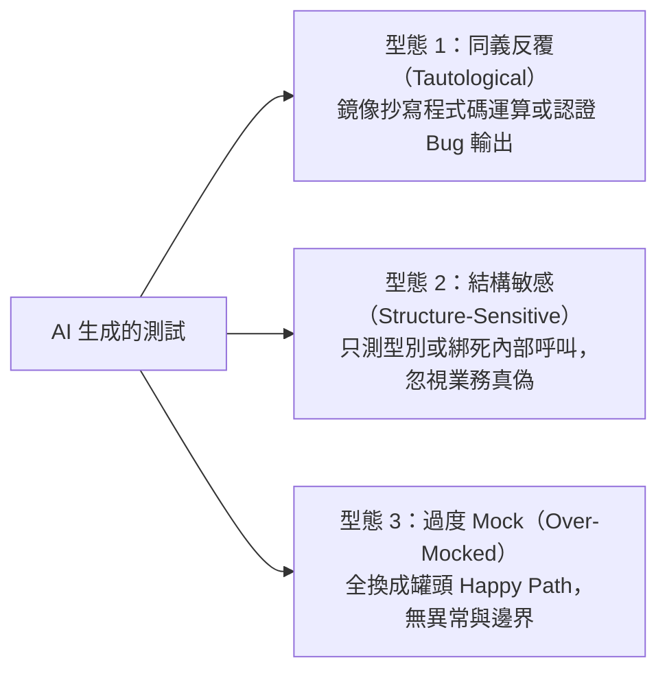

# 假綠燈檢測器（False Green Detector）v1.0

> **戳破 AI 生成測試的全綠謊言，讓測試驗證真實行為，而非盲目求過。**  
> 一個為 Claude Code、Codex、Cursor、Antigravity 及各類 LLM Coding Agent 設計的開源測試驗收治理 Skill：檢測同義反覆（Tautological）、結構敏感（Structure-Sensitive）與過度 Mock（Over-Mocked）三大假綠燈型態，提供驗真檢查清單、Max Out Lint 規則包與實跑對照範例。

[](https://opensource.org/licenses/MIT)
[](#)
[](#)
[](#)

---

## 為什麼需要本專案？（痛點與背景）

### 1. 痛點起源：全綠 CI 帶來的虛假安全感
在 AI 輔助寫碼時代，「寫代碼」與「寫測試」變得無比快速。然而，當 AI 在同一個上下文或同一批次中同時產出實作與測試時，**測試的真理來源往往成了程式碼本身，而不是業務規格**。

這導致了極度危險的「假綠燈（False Green）」現象：
- 測試 100% 通過、覆蓋率高達 90%+。
- 測試實質上只是把程式碼的邏輯又重抄了一次，或者直接把程式碼算出來的 Bug 輸出斷言為「預期結果」。
- 關鍵邊界（如剛好滿 100 元）無折扣、折抵金額穿透為負數等嚴重缺陷被測試認證為合法行為。
- 上線後遇到真實用戶瞬間觸發事故，帶來高昂的重工與溝通成本。

### 2. 理論與思想來源
本專案核心理念源自 TypeScript 領域知名教育家與 AI Hero 創辦人 **Matt Pocock** 於 TechLead Conference London 2026（GitNation 主辦）發表的專題演講：
- **演講名稱**：*Why Software Fundamentals Still Matter*
- **YouTube 演講影片**：https://www.youtube.com/watch?v=Jijr_peax0g
- **核心警示章節**：
  - `02:04` - The AI Speed Trap: Why Your Software Factory Needs Brakes
  - `03:17` - Three Guardrails That Keep AI Agents from Producing Slop
  - `04:40` - Max Out Your Lint Rules: Give AI Agents Less Room to Make Bad Decisions
  - **`06:03` - Green Tests Can Lie: Three Ways AI-Generated Tests Create False Confidence**
  - `09:18` - Deep Modules, Better Architecture: Make Your Code Harder for AI to Test Badly
  - `13:33` - Stop Trusting the Coding Agent with Your Standards: Use a Separate AI Reviewer

### 3. 誠實聲明（Honesty & Zero-Hallucination Policy）
> [!NOTE]
> 本專案經實查核實演講內容與公開章節（06:03 等），但未下載到完整 SRT 逐字稿。本工具之具體反模式文字分類與清單內容，係對照 Matt Pocock 公開論述、結合工程實戰經驗交叉整理而成；其中僅「同義反覆」與其 tdd skill 點名的 tautological 反模式同名，其餘兩型態為實務整理，非 Matt 原文分類。本專案不編造演講未提及之數字與引言。

---

## 倉庫目錄結構

```text
false-green-detector/
├── LICENSE                         # MIT 開源授權條款
├── README.md                       # 專案介紹、理論來源、使用說明與誠實聲明
├── SKILL.md                        # Claude Code / Codex / Antigravity 可直接載入之 Skill 主檔
├── 假綠燈檢測檢查清單.md              # 供 Code Review 逐項勾選的五大面向核對清單
├── 範例與改前改後對照.md              # 完整業務案例深度剖析與實跑對照手冊
├── examples/                       # 0 依賴可直接實跑的程式碼範例
│   ├── typescript/                 # TypeScript / Node.js 內建測試運行器範例
│   │   ├── src/order-calculator.ts # 包含 Buggy 與 Fixed 兩套實作
│   │   └── test/                   # 包含假綠燈、抓蟲紅燈、真綠燈測試集
│   └── python/                     # Python 內建 unittest 測試範例
│       ├── order_calculator.py     # 包含 Buggy 與 Fixed 兩套實作
│       └── test_*.py               # 假綠燈與行為驗證測試
├── lint-rules/                     # 靜態防護規則配置包
│   ├── eslint.config.js            # ESLint Flat Config 範本（Vitest / Jest / TS）
│   ├── ruff.toml                   # Python Ruff 測試檢查範本
│   └── README.md                   # Lint 規則功能與支援度詳細說明
└── skills/
    └── false-green-detector/
        └── SKILL.md                # 遵循 Anthropic Skill 標準規範之檔案放置位
```

---

## 三大假綠燈型態解析



1. **同義反覆測試（Tautological Tests）**：  
   測試缺乏獨立預期，直接重寫被測函式的運算式，或者將程式碼目前輸出的值（即便有 Bug）直接當成期待值。程式碼出錯，測試也跟著放行。
2. **結構敏感測試（Structure-Sensitive Tests）**：  
   只斷言物件形態（`typeof res.total === 'number'`）或刺探內部私有成員與執行次數，未驗證對外可觀察的公開行為。
3. **過度 Mock 測試（Over-Mocked / Mock Theatre）**：  
   把資料庫、外部 API 全換成永遠回傳成功的罐頭資料，斷言只檢查 `toHaveBeenCalled()`。產線環境一旦遇到 404/500/超時立即癱瘓。

---

## 五大驗真檢查清單概覽

在合併代碼前，請強制逐一確認：
1. **獨立規格預期**：期待值必須來自 PRD 或手工計算，嚴禁由被測代碼邏輯推導。
2. **邊界與極限覆蓋**：精確測試臨界門檻點（如 $99、$100、$101）、0、空集合。
3. **負向異常阻斷**：折抵金額大於本金不可擊穿為負額；無效輸入必須拋出明確異常。
4. **Mock 合約真實性**：不 Mock 核心演算法；所有 Mock 必須包含失敗路徑測試。
5. **突變破壞性測試**：隨機修改原始碼運算子（如 `>=` 改 `>`），測試套件必須立刻亮起紅燈！

---

## 快速上手與使用方式

### 方式 1：作為 Claude Code / Antigravity 本機 Skill 使用（推薦）
將本倉庫複製至工作目錄中：
```bash
git clone https://github.com/Agents-use9/false-green-detector.git
```
在對話中直接載入：
```bash
claude --skill ./false-green-detector/SKILL.md
```
或直接複製到您的使用者技能目錄：
```bash
cp -r false-green-detector/skills/false-green-detector ~/.claude/skills/
```

### 方式 2：在 Cursor / Codex / 任意 LLM 中使用
直接將 `SKILL.md` 全文貼入您的 System Prompt、Custom Instructions 或專案 `.cursorrules` 中。

---

## 常用審查指令（Slash Commands）

當本 Skill 載入後，您可以使用以下指令快速呼叫功能：

- `/false-green-audit`：調用獨立審查視角，掃描現有測試檔案中的三大假綠燈反模式。
  - *可參考的審查 Prompt（概念對照演講審查思路，非 Matt 原文）*：
    `"Explore my test suite and identify tests or groups of tests that are tautological, structure-sensitive, or where mocks don't match reality."`
- `/false-green-check`：對特定測試檔案逐項執行「五大面向驗真檢查清單」。
- `/false-green-mutate`：對被測代碼植入突變探針，驗證測試套件是否具備實質抓蟲能力。
- `/false-green-lint`：檢視或輸出專案專用的防護 Lint 配置（ESLint / Ruff）。

---

## 本機範例即時實跑（0 依賴）

您可以直接在終端機執行本倉庫自帶的實戰範例：

```bash
# 進入 TypeScript 範例目錄
cd examples/typescript

# 1. 執行 AI 假綠燈測試（展示 3 個測試全數全綠的謊言）
node --test test/fake-green.test.ts

# 2. 執行真實行為驗收測試跑在 Buggy 代碼上（展示精確抓出 3 處紅燈缺陷）
node --test test/verify-bugs.test.ts

# 3. 執行真實行為測試跑在修復後代碼上（展示真正的真綠燈）
node --test test/behavioral.test.ts
```

---

## 授權條款（License）

本專案採用 [MIT License](LICENSE) 開源授權，完全免費、開源，供全世界軟體工程師自由使用與貢獻。
