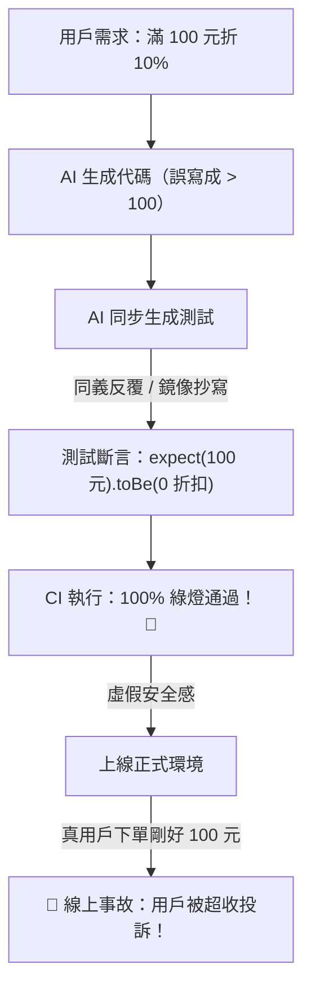
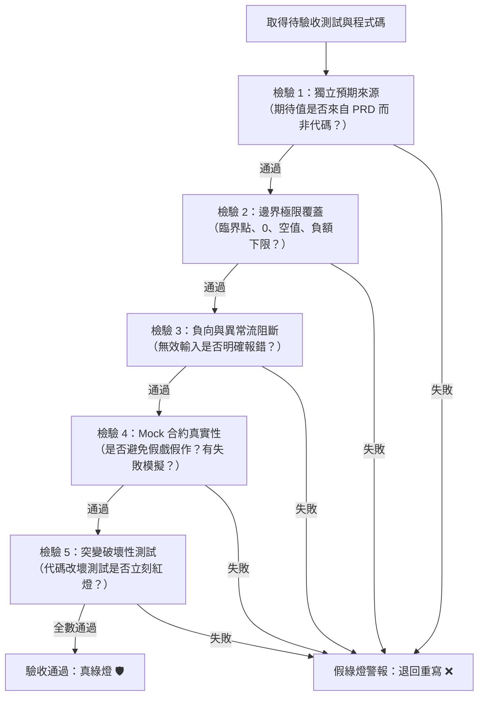

# 假綠燈檢測器（False Green Detector）v1.0

本 Skill 旨在協助軟體工程師、架構師與使用 AI Agent（Claude Code、Codex、Cursor、Antigravity 等）進行輔助開發的團隊，在驗收 AI 生成的程式碼與測試套件時，主動檢測並消除**「假綠燈（False Green）」**現象——即 CI 顯示 100% 綠燈通過、覆蓋率居高不下，但測試實質上**根本沒有驗證真實業務行為**，甚至反向為程式碼中的 Bug 蓋章背書的致命盲區。

---

## 來源依據與誠實聲明（Source & Honesty Policy）

### 1. 痛點核心依據
本專案之核心思想源自 TypeScript 教育家與 AI Hero 創辦人 **Matt Pocock** 於 TechLead Conference London 2026（GitNation 主辦）發表的專題演講：
- **演講講題**：*Why Software Fundamentals Still Matter*
- **YouTube 連結**：https://www.youtube.com/watch?v=Jijr_peax0g
- **關鍵核心章節**：
  - `02:04` - The AI Speed Trap: Why Your Software Factory Needs Brakes
  - `03:17` - Three Guardrails That Keep AI Agents from Producing Slop
  - `04:40` - Max Out Your Lint Rules: Give AI Agents Less Room to Make Bad Decisions
  - **`06:03` - Green Tests Can Lie: Three Ways AI-Generated Tests Create False Confidence**
  - `09:18` - Deep Modules, Better Architecture: Make Your Code Harder for AI to Test Badly
  - `13:33` - Stop Trusting the Coding Agent with Your Standards: Use a Separate AI Reviewer

### 2. 誠實邊界與未逐字聲明（Honest Boundary）
> [!IMPORTANT]
> **未逐字對照演講原文聲明**：
> 雖然我們精確核實了 YouTube 演講影片的存在、章節分段（06:03）、演講簡介與社群公開探討主題，但受限於官方字幕即時擷取管道，本 Skill 未下載到完整的演講逐字稿（SRT）。因此，文內關於「三種假綠燈型態」與「驗真防護」之具體文字描述，係對照 Matt Pocock 在該講題與公開技能庫（`mattpocock/skills`）之核心論述、結合現代軟體工程測試實務交叉整理而成；其中僅「同義反覆」與其 tdd skill 點名的 tautological 反模式同名，其餘兩型態為實務整理，非 Matt 原文分類。
> 本 Skill **絕不將改寫或延伸之說明偽稱為 Matt Pocock 的逐字引言**，亦不捏造演講未提及之統計數據。

---

## 一、什麼是「假綠燈」？（The False Green Problem）

### 1. 產生機制：AI 在同一 Pass 中寫碼又寫測試
在 AI 輔助開發的工作流中，工程師常向模型下達：「幫我寫出購物車折扣功能，並附上完整的單元測試」。  
此時，AI 往往在**同一個上下文（Context Window）或同一個 Pass 中**同時產出業務代碼與測試代碼。

這會帶來致命的自指偏差（Self-Referential Bias）：
- AI 生成的測試，其真理來源**不是業務需求規格（PRD）**，而是它**剛剛產出（甚至可能帶有 Bug）的程式碼**。
- 測試斷言（Assertions）的預期值，被 AI 設計為「剛好能讓程式碼跑過」。
- **結果**：測試只驗證了「這段程式碼是否符合它自己的假設」，而非「這段程式碼是否符合真實世界的要求」。

### 2. 虛假安全感（False Confidence）的代價
當開發者看到終端機或 CI/CD 管道跳出：
```text
Test Suites: 1 passed, 1 total
Tests:       12 passed, 12 total
Coverage:    94.5% All files
```
大腦會立即分泌多巴胺，誤以為功能已經堅不可摧。然而：
- 臨界點計算錯誤（如滿 100 元無折扣）被測試視為正常。
- 負數金額擊穿被罐頭 Mock 掩蓋。
- 系統一推上正式環境，遇到真實用戶輸入便瞬間崩潰，重工與事故代價極高。



---

## 二、三種假綠燈型態與判別方法（Three Anti-Patterns）

對照演講 `06:03` 章節的核心警示（未逐字對照原文，見上節聲明）與測試實務，AI 生成的假綠燈測試主要呈現為三大典型反模式：

### 型態 1：Tautological Tests（同義反覆測試／鏡像自證測試）
- **本質**：測試沒有獨立的預期，而是重覆實作了一遍被測邏輯，或者直接把程式碼目前算出的輸出值寫入斷言。
- **典型現象**：
  - 程式碼內部寫 `return x * 1.05;`，測試也寫 `expect(calc(x)).toBe(x * 1.05);`。
  - 程式碼因為邏輯錯誤算出 `discount: 0`，測試就直接寫 `expect(res.discount).toBe(0);`。
- **為什麼是假綠燈**：當業務需求變更或程式碼有邏輯 Bug 時，同義反覆測試永遠不會報錯，因為它只是一面「鏡子」，程式碼犯錯它就跟著犯錯。
- **判別方法**：
  1. **黃金樣本檢查**：測試中的期待值是否為手工算定的常數？若期待值包含演算法推導，是否與被測函式如出一轍？
  2. **手動突變（Mutation）**：故意將被測函式中的 `>` 改為 `>=` 或將折扣率由 `0.1` 改為 `0.2`。若測試依然綠燈通過，該測試必定為同義反覆！

---

### 型態 2：Structure-Sensitive Tests（結構敏感測試／細節綁定型測試）
- **本質**：測試不關心對外可觀察的業務結果（Observable Public Behavior），而是深入刺探模組內部的私有狀態、暫存變數、內部 Helper 的呼叫次數或物件結構型別。
- **典型現象**：
  - 斷言只檢查 `typeof res.total === 'number'` 或 `expect(res).toHaveProperty('id')`，完全無視數值到底對不對。
  - 刺探私有欄位（如 `instance._internalState`），但對外暴露的 API 返回卻從未核驗。
  - 斷言過度綁定內部調用順序（如要求私有函式必須被呼叫剛好 2 次），一旦進行內部重構，代碼行為完全正確，測試卻頻繁脆裂（Brittle Tests）。
- **為什麼是假綠燈**：它給出「我有測到內部每個細節」的假象，但實質上連最基礎的「滿 100 折 10」都沒有驗證。
- **判別方法**：
  1. 測試斷言是否只檢查型別而無精確數值？
  2. 嘗試將內部實作換一種寫法（例如將 for 迴圈改為 reduce），若對外結果完全一致但測試全面報錯，代表測試過度綁定結構。

---

### 型態 3：Over-Mocked / Mock Theatre Tests（過度 Mock／假戲假作測試）
- **本質**：AI 為了讓測試能快速且無阻礙地通過，將所有可能出錯的外部依賴（資料庫、網路 API、驗證服務、時間、檔案系統）全部 Mock 掉，且 Mock 一律返回完美的罐頭假資料（Canned Happy Path Data）。
- **典型現象**：
  - 整個測試檔案有 80% 的行數都在配置 Mock。
  - 斷言僅檢查 `expect(apiMock).toHaveBeenCalled()`，完全沒有驗證應用程式收到特定回應（或錯誤回應）後的行為。
  - 從未模擬過真實世界的失敗場景：HTTP 500、網路超時、無效憑證、空集合、並發衝突。
- **為什麼是假綠燈**：測試驗證的不是軟體本身，而是「Mock 有沒有按照預期回傳罐頭資料」。一到生產環境，真實依賴的合約稍有不同，系統立即崩潰。
- **判別方法**：
  1. 統計測試檔案中 Mock 的數量是否超越被測邏輯本體？
  2. 嘗試讓 Mock 拋出異常或回傳非標準格式資料，觀察系統是否有任何防禦機制？如果整個測試套件中「沒有任何一個 Mock 模擬失敗場景」，則必定為假戲假作。

---

## 三、驗真檢查清單（Verification Checklist）

在審查任何 AI 生成的測試前，強制逐一執行以下五大面向核驗：



### 1. 獨立預期維度（Independent Expectation）
- [ ] **拒絕鏡像**：測試的期待值（Expected Value）必須直接來自業務規格書或手工計算，嚴禁在測試中重寫運算邏輯來推導結果。
- [ ] **黃金數值**：關鍵數值斷言必須為字面常數（例如 `assert.strictEqual(res.total, 90)`），而非引用被測模組內部的動態常數。

### 2. 邊界與極限維度（Boundary & Edge Cases）
- [ ] **臨界點必測**：凡有 `>=` 或 `<=` 門檻，必須同時覆蓋門檻值（Threshold）、門檻前一值（Threshold - 1）與門檻後一值（Threshold + 1）。
- [ ] **下限防護**：涉及折抵、退款、扣點數等場景，必須測試「折抵額大於本金」的情境，確保金額不擊穿為負數。
- [ ] **空狀態處理**：必須測試空陣列、空字串、0 與 null/undefined。

### 3. 負向異常維度（Negative & Error Paths）
- [ ] **主動阻斷驗證**：非法輸入（如負數單價、負數數量、過期 Token）必須有對應的測試，驗證系統會明確拋出預期之例外或回傳錯誤狀態。
- [ ] **精確錯誤比對**：斷言異常時，必須比對錯誤型別或錯誤訊息文字，禁止使用空 catch 或寬鬆的模糊捕捉。

### 4. Mock 邊界維度（Anti-Mock Theatre）
- [ ] **不 Mock 核心**：絕對不可 Mock 要證明的核心業務演算法。
- [ ] **真實失敗模擬**：所有被 Mock 的外部服務，必須具備至少一組失敗路徑測試（如 Mock 拋出網路連線逾時）。
- [ ] **合約嚴格性**：Mock 的資料結構必須受型別系統約束，禁止隨意捏造不存在的欄位。

### 5. 突變破壞性維度（Mutation Resilience）
- [ ] **破壞性探針**：隨機修改原始碼中一個運算子（例如把 `>=` 改為 `>`），測試套件必須立刻亮起紅燈！
- [ ] **若代碼改壞而測試依然全綠，該測試無效，立即退回！**

---

## 四、Max Out Your Lint Rules：代碼檢查防護包

> **Matt Pocock 演講理念（04:40，意譯，非逐字引言）**：  
> CPU 週期相對便宜，AI 的 Context Window 與工程師的專注力相對昂貴；把 Lint 規則開到最大，就是用最廉價的機器力，為隨機性高的 AI 代碼加上煞車。

### 1. TypeScript / JavaScript（ESLint + Vitest / Jest）
完整的配置範本位於專案目錄 `lint-rules/eslint.config.js`。

| 規則識別碼 | 功用與阻斷之假綠燈型態 | 支援狀態 |
| :--- | :--- | :---: |
| `vitest/expect-expect` | 強制每個測試必須包含實質 `expect()`，杜絕「跑完沒噴錯就當綠燈」的空測試。 | 【已核實】官方外掛 |
| `vitest/no-conditional-expect` | 禁止在 `if`、`catch` 或迴圈中放置斷言，防止因條件未滿足而靜默跳過斷言。 | 【已核實】官方外掛 |
| `vitest/valid-expect` | 確保 `expect(...)` 語法完整且附帶合法 Matcher，防止殘缺斷言。 | 【已核實】官方外掛 |
| `@typescript-eslint/no-floating-promises` | 強制非同步呼叫必須 await，防止非同步測試未執行完畢即判定綠燈。 | 【已核實】TS 官方 |
| `no-restricted-syntax` (AST) | 自訂 AST 限制，直接禁用 `expect(true).toBe(true)` 等自欺欺人灌水斷言。 | 【已核實】ESLint 核心 |

### 2. Python（Ruff / Flake8）
完整的配置範本位於專案目錄 `lint-rules/ruff.toml`。

| 規則識別碼 | 功用與阻斷之假綠燈型態 | 支援狀態 |
| :--- | :--- | :---: |
| `flake8-pytest-style` (PT015) | 禁止斷言常數或永遠為真的條件（如 `assert True` 或 `assert 1 == 1`）。 | 【已核實】Ruff 內建 |
| `flake8-pytest-style` (PT018) | 禁止複合斷言（`assert a and b`），避免斷言短路隱藏失敗細節。 | 【已核實】Ruff 內建 |
| `flake8-pytest-style` (PT011) | 強制 `pytest.raises()` 必須具備 `match` 參數，防止任何無關異常被誤判為通過。 | 【已核實】Ruff 內建 |

---

## 五、改前改後實跑範例（Runnable Examples）

本專案提供具備完整業務規格、可實際在終端機運行的真實對照範例。
程式碼檔案位於 `examples/typescript/` 與 `examples/python/`。

### 快速驗收指令（TypeScript，免額外依賴）：
```bash
# 1. 執行 AI 假綠燈測試（展示 3 個測試全數全綠的假象）
node --test examples/typescript/test/fake-green.test.ts

# 2. 執行真實行為驗證測試跑在 Buggy 代碼上（展示精確抓出 3 處紅燈缺陷）
node --test examples/typescript/test/verify-bugs.test.ts

# 3. 執行真實行為測試跑在修復後代碼上（展示真綠燈）
node --test examples/typescript/test/behavioral.test.ts
```

完整案例程式碼、缺陷深度分析與重構細節，請參閱 [範例與改前改後對照.md](file:///home/hatch/workspace/goals/goal-4/files/antigravity/draft-12-假綠燈檢測Skill/範例與改前改後對照.md)。

---

## 六、常用審查指令（Slash Commands）

當本 Skill 啟用時，可使用以下語法調用各項檢測功能：

- `/false-green-audit`：調用獨立審查視角，掃描當前測試套件中的三大反模式（同義反覆、結構敏感、過度 Mock）。
  - *可參考的審查 Prompt（概念對照演講審查思路，非 Matt 原文）*：
    `"Explore my test suite and identify tests or groups of tests that are tautological, structure-sensitive, or where mocks don't match reality."`
- `/false-green-check`：對照五大面向檢查清單，對特定 PR 或新生成的測試檔案進行逐項勾選核驗。
- `/false-green-mutate`：對被測代碼執行破壞性突變測試探針，檢驗測試是否具備真正的抓蟲能力。
- `/false-green-lint`：檢視或輸出專案適用的假綠燈防護 Lint 配置（ESLint / Ruff）。
